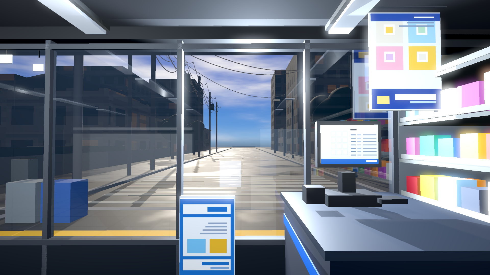
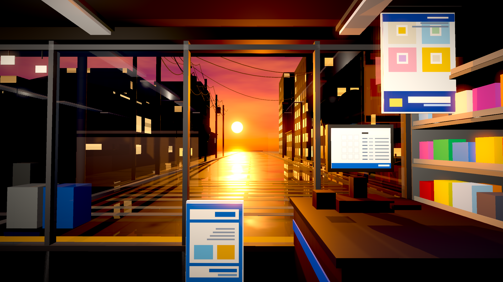
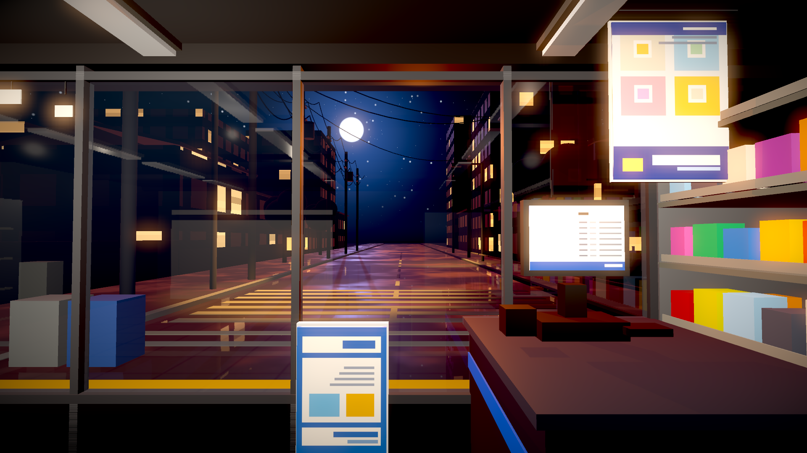

# Market 3D 预研场景

> 工程：`D:\Development_Of_Games\Program\Source\kuerss\Market 3D project`（Unity 2023.1.12f1、3D 模板、**Built-in 管线**、Linear 色彩空间）。
> 目的：验证"便利店店内 → 玻璃幕墙 → 雨后落日街道"这种**单镜头氛围场景**能到什么程度。
> 参考图：用户提供的 Lawson 门口夕阳实拍。
> 场景文件：`Assets/Scenes/Market.unity`（不是游戏关卡，是纯预研镜头）。
> 2026-11-17 从 TenPercent2D 工程整体迁出。
>
> **玩法/设计设定见 [便利店怪谈_设计文档.md](便利店怪谈_设计文档.md)；本文只讲 Market 场景与时间系统。**
> 旧设计文档、旧评审、旧 MVP、旧 30 天经济模型已删除，不要参考。


---

## 1. 怎么重新生成

- 菜单：`Market3D > 生成 Market 场景`
- 菜单：`Market3D > 导出当前视角预览图` → `Docs/Previews/market3d_preview.png`
- 菜单：`Market3D > 导出三时段预览图` → `Docs/Previews/market3d_day.png` / `market3d_dusk.png` / `market3d_night.png`
- 也可以用 MCP `execute_code` 直接调（先 `set_active_instance` 切到这个工程）：
  ```csharp
  TenPercent2D.Market3D.MarketSceneBuilder.Build();
  TenPercent2D.Market3D.MarketSceneBuilder.CapturePreview("Docs/Previews/market3d_preview.png");
  ```

**MCP 注意**：工程里有个 `Assets/Market3D/Editor/MarketMcpBoot.cs`，编辑器加载时会自动把 MCP 桥拉起来（端口 6400），省得每次手动点 Start Bridge。它的唯一作用就是这个，不想要可以在 `Window > MCP for Unity` 里改成「Auto-Start on Editor Load」后删掉。

**注意**：生成器是**全程序化**的。每次 Build 会新建空场景、重建所有物体、覆盖 `Assets/Market3D/Materials` 与 `Generated` 下的资源。
**不要在那个场景里手改物体**——下次 Build 会被冲掉；要改就改 `MarketSceneBuilder.cs`。

---

## 2. 目录

```
Assets/Market3D/
  Editor/MarketSceneBuilder.cs      # 全部几何/材质/灯光/相机，改这里
  Editor/TimeOfDayPreview.cs        # 三时段预览图导出
  Scripts/PlanarReflection.cs       # 平面反射相机（水平面 + 竖直面各一个）
  Scripts/MarketPostFX.cs           # 轻量后期：泛光 + 调色 + 暗角（不依赖 Post Processing Stack）
  Scripts/MarketCameraDrift.cs      # 播放时的轻微手持呼吸感
  Scripts/TimeOfDay/TimeOfDaySystem.cs    # 24h 时间轴 / 预设插值 / 灯光与材质总控
  Scripts/TimeOfDay/TimeOfDayPreset.cs    # 白天 / 黄昏 / 星空夜三套光照配方
  Scripts/TimeOfDay/TimeOfDayHUD.cs       # 左下角时间 HUD（IMGUI）
  Shaders/TimeOfDaySky.shader       # 时间系统天空盒（渐变 + 云 + 太阳 + 月亮 + 星空 + 银河）
  Shaders/SunsetSky.shader          # 第一版日落天空盒，保留作参考
  Shaders/WetAsphalt.shader         # 湿沥青：程序化噪声 + 积水 + 屏幕空间反射
  Shaders/GlossyTile.shader         # 店内瓷砖地面（同样吃反射 RT）
  Shaders/Glass.shader              # 玻璃：半透明 + 屏幕空间反射
  Shaders/Facade.shader             # 远景建筑立面（世界坐标生成窗格 + 亮灯）
  Shaders/PostFX.shader             # 后期三步（亮部 / 模糊 / 合成）
  Generated/                        # 程序化画出来的贴图：瓷砖、海报、POS 屏、蓝色立牌
  Materials/                        # 生成器写出的全部材质
```

---

## 3. 构图参数（`MarketSceneBuilder.cs` 顶部常量）

| 参数 | 值 | 说明 |
|---|---|---|
| `CameraPos` | (0.75, 1.55, -3.00) | 站在收银台左后方，距玻璃 3 m |
| `CameraFov` / `CameraPitch` | 55 / -1.5° | 竖 FOV 55 ≈ 横 91°，广角感；轻微俯一点让地平线低于画面中线 |
| `CeilingY` | 2.95 | 压低天花板 → 天花板只占画面顶部约 10% |
| `CounterX0..Z1` | x 1.20~2.40 / z -1.60~0.00 | 收银台，近端正好切在画面右下角外 |
| `ShelfFrontX / BackX` | 2.55 / 3.95 | 右侧货架，从玻璃一直排到身后 |

改取景只动这几行 + 收银台/货架常量，重新 Build 即可。

---

## 4. 视觉关键点（哪些地方在撑画面）

1. **天空盒**（`TimeOfDaySky`）：三层色（地平线橘 → 低空粉 → 洋红 → 天顶靛紫）+ 太阳圆盘和三层光晕 + 用「方位角/仰角」铺的程序化云（`atan2/asin` 投影，避免平面投影在地平线附近被拉成细条）。白天换成蓝白配色，夜里再叠程序化星场和月亮。第一版 `SunsetSky` 保留作参考。
2. **湿路面**（`WetAsphalt`）：底色是程序化 fbm 噪声，积水遮罩控制反射强度；反射用 `PlanarReflection` 生成的**镜像相机 RT**，按屏幕 UV 采样并加一点扰动 → 才有那根被夕阳拉长的反光。
3. **玻璃**（`Glass`）：半透明 + 另一台镜像相机的 RT（法线朝店内的竖直平面），所以玻璃上会叠出店里货架的影子——参考图里左边那几块玻璃就是这个效果。
4. **店内瓷砖**（`GlossyTile`）：和湿路面共用**同一个** y=0 平面反射 RT，只是反射强度低一些。
5. **立面**（`Facade`）：按世界坐标算窗格，随机亮灯，不依赖任何贴图；亮窗强度随昼夜变化。
6. **后期**（`MarketPostFX`）：亮部提取 → 3 次双向模糊 → 曝光/对比/饱和/暖调/暗角。阈值和调色随预设走：黄昏 1.95（只让太阳和灯管发光）、白天 1.55、星空夜 1.35（让星星和路灯更亮）。

---

## 5. 打光（Built-in 没有实时 GI，全靠凑）

| 光源 | 用途 |
|---|---|
| Directional `SunLight` | 昼/黄昏的主光，方向和天空盒太阳一致，软阴影；夜里降到 0 |
| Directional `MoonLight` | 夜里接替太阳的冷色月光，强度和太阳交叉淡化 |
| Spot `WindowSpillLight` | 窗口处朝店内打：白天是冷白天空光，黄昏是暖橘落日，夜里是店内溢出的暖光 |
| Point ×5 `FluoroLight` | 货架顶下的暖白补光（黄昏 1.85 / range 9），白天调冷调暗、夜里略提亮 |
| Spot ×2 `LampSpot` | 路灯灯头下的聚光，夜里在湿路面打出两团暖色光斑 |
| Point ×2 `LampGlow` | 路灯灯头处的点光，给灯罩一圈近距离辉光 |
| Ambient | Trilight：天顶/赤道/地面三色随预设变化 |
| Fog | 指数平方，颜色和密度随预设变化；夜里更蓝更浓 |

材质自发光只给灯管 / 海报 / POS 屏 / 冷柜 / 店招 / 路灯灯罩，其余全靠上面的灯。
自发光强度、立面亮窗、湿面反射都用 **MaterialPropertyBlock** 改，不会污染 `.mat` 资源。

---

## 6. 时间系统：白天 / 黄昏 / 星空夜

> 游戏玩法里：**18:20 用于进货，STARRY NIGHT 用于夜班**；这里的 `DAY / DUSK / STARRY NIGHT` 只是场景光照预设，不是玩法阶段命名。

场景现在有 3 套完整光照预设。打开场景默认是**黄昏**（保持原来那张图的第一眼），
进入 Play 后可以随时切：

| 键 | 预设 | 时钟 | 画面 |
|---|---|---|---|
| `1` | `DAY` | 14:00 | 高太阳、蓝天白云、路灯/立面亮窗关闭、店内灯调冷调暗、湿面反射减弱 |
| `2` | `DUSK` | 18:20 | 原来的落日街道：低太阳、洋红橙天空、暖色窗光、强湿面反射 |
| `3` | `STARRY NIGHT` | 23:00 | 深蓝夜空 + 月亮 + 星空/银河、路灯暖光斑、立面亮窗、泛光更强 |

其他操作：

| 键 | 功能 |
|---|---|
| `T` | 开关自动时间流逝（默认关，方便定住看；一整天 120 秒，可在 Inspector 改） |
| `Space` | 切到下一个时段 |
| `←` / `→` | 时间 ±15 分钟 |
| `H` | 显示 / 隐藏左下角 HUD |

HUD 也可以直接用鼠标操作：点 `1 DAY` / `2 DUSK` / `3 NIGHT` 切时段，点 `T AUTO` 开关自动流逝，点 `H HIDE` 收起（再按 `H` 回来），拖动 24 小时时间条可以直接拨时间。

**为什么不是三套光直接对撞：** 手动切时段时，系统会把 24h 时钟平滑推到目标时刻，
画面始终按时间轴求值。所以 `白天 → 星空夜` 会先经过 17:00 的日落、18:20 的黄昏、
21:00 的入夜，不会出现"白天天空里挂着一轮月亮"的中间帧。反过来 `星空夜 → 白天`
会经过黎明。

时间轴关键帧（`TimeOfDaySystem.CreateDefaultKeyframes`）：

```
00:00 夜  04:00 夜  06:00 夜  08:00 白天  17:00 白天
18:20 黄昏  19:30 黄昏  21:00 夜  24:00 夜
```

**平滑切换的实现：**

- 三套预设是 `TimeOfDayPreset`，包含天空渐变、太阳/月亮的颜色与强度、星空、云、
  环境光、雾、太阳/月亮/店内灯/路灯、立面亮窗、自发光、湿面反射、后期共几十个参数。
- `TimeOfDaySystem` 每帧按当前时钟在相邻关键帧之间 `Color.Lerp`，太阳/月亮的**方向**
  由日轨单独计算，不参与预设插值。
- 天空盒用 `Market/TimeOfDaySky`：白天/黄昏保留原来的渐变和程序化云，夜里额外画
  程序化星场（按方位角×仰角分格哈希）和月亮圆盘/光晕。
- 发光材质和湿面反射用 MPB 覆盖，所以三套预设切换不会把 `.mat` 改脏。

**太阳 / 月亮轨迹：**

- 把街道朝向约定成“西”：`+z` 是落日方向，`+x` 是北，`+y` 是天顶。
- 太阳绕天极 `P`（正北、高度 45°）以 15°/小时转；`18:20` 正好经过原来黄昏的太阳位置，
  所以日落构图不变，但 10:00 / 14:00 / 16:00 / 17:00 的太阳高度和方位会按真实日轨走。
- 月亮同样绕 `P` 以 15°/小时转；`23:00` 正好经过原来星空夜的月亮位置，其余时间自然
  升落，不会整晚钉在同一个点。
- 太阳/月亮落到地平线以下时，系统会把本体、光晕和光照一起淡出，避免“地下月亮”继续打光。

**文件：**

- `Assets/Market3D/Scripts/TimeOfDay/TimeOfDaySystem.cs` — 时间轴、控制、灯光/材质应用
- `Assets/Market3D/Scripts/TimeOfDay/TimeOfDayPreset.cs` — 三套预设数据（可在 Inspector 微调）
- `Assets/Market3D/Scripts/TimeOfDay/TimeOfDayHUD.cs` — 左下角 HUD
- `Assets/Market3D/Shaders/TimeOfDaySky.shader` — 统一天空盒
- `Assets/Market3D/Editor/TimeOfDayPreview.cs` — 三时段预览图导出

**三时段预览：**







> 预览图由 `Market3D > 导出三时段预览图` 生成；它会分帧套预设并刷新环境探针，
> 避免光滑表面残留上一个时段的反射色。真正跑起来的第一手效果以 Play 模式为准。

---

## 7. 已知限制

- **是"预研级"还原，不是照片级**。几何全是盒子和圆柱，参考图里的货品、招牌文字、雨痕都是示意。
- 没有真实 GI：室内亮度靠手调点光源 + 环境光，换个视角会显得"灯是假的"。
- 平面反射只对 y=0 和 z=0 两个平面正确；别的湿面（比如远处人行道）有轻微错位。
- 店内没有碰撞体（生成时把 Collider 全删了），要走路得另外加。
- 每帧多渲染两台镜像相机（1280×720 + 1024×576），在编辑器里 `[ExecuteAlways]` 也会跑；嫌卡就把 `PlanarReflection` 组件禁用。
- 天空盒云是程序化噪声，远看有味道，凑近看是花纹。

## 8. 下一步（如果继续做）

1. 店招 / 招牌文字：贴图生成太麻烦，换成 TMP 世界空间文字或图集。
2. 玻璃雨痕 + 屏幕空间反射模糊（现在是零模糊的镜面）。
3. 用反射探针或 SSR 替掉平面反射，室内可自由转视角。
4. 固定柜台视角的交互/UI 原型；当前玩法已锁 PC + 柜台，不做第一人称走动。
5. 时间系统已经能切三时段；下一步可以接天气（晴/雨/雾）、把时钟暴露给关卡脚本，或者给路灯加体积光锥。
